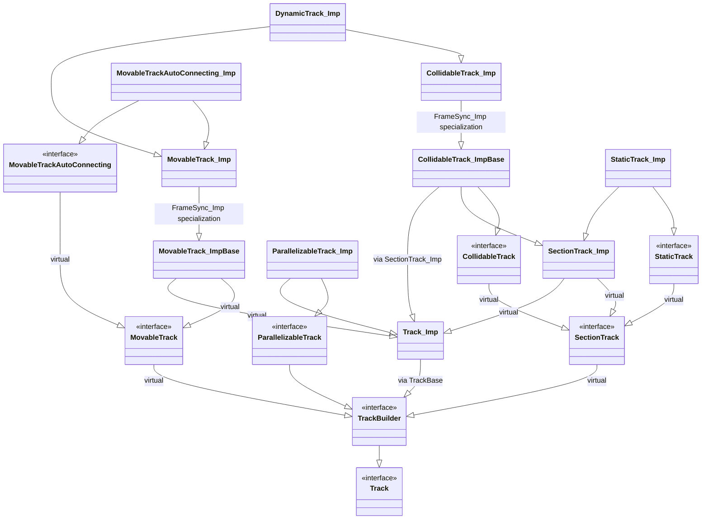

# Track class diagram

This diagram includes the public Track interfaces and the implementation classes derived from them. The synchronized implementations inherit through `FrameSync_Imp` specializations, indicated on those inheritance edges.

`TrackBase` is a type alias for the `TrackBuilder` implementation base, so `Track_Imp` derives from `TrackBuilder` through that alias. `TrackCollection` and `TrackSystem` hold tracks but are not Track subclasses.